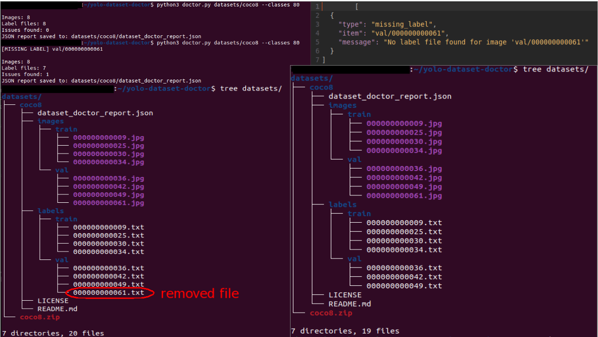

# YOLO Dataset Doctor

A lightweight Python command-line tool for detecting common problems in YOLO object detection datasets.

## Features

- Detect missing label files
- Detect orphan label files
- Validate YOLO annotation format
- Check class IDs against the configured class count
- Validate bounding box coordinates
- Detect invalid or non-finite values
- Generate JSON validation reports
- Support nested image and label directories

## Sample Health Report

See an example of the HTML report generated by YOLO Dataset Doctor:

[View Sample HTML Health Report](docs/sample-report.html)

The report includes dataset statistics, validation findings, and recommendations for fixing annotation issues.

## Real-World Test: Ultralytics COCO8

YOLO Dataset Doctor was tested using the public [Ultralytics COCO8 dataset](https://docs.ultralytics.com/datasets/detect/).

### Experiment

We performed a controlled test:

1. Downloaded the original COCO8 dataset.
2. Ran YOLO Dataset Doctor against the original dataset.
3. Confirmed that all 8 images had corresponding label files.
4. Deliberately removed `000000000061.txt` from the validation labels.
5. Ran the validator again.

### Results

| Metric | Original dataset | Modified dataset |
|---|---:|---:|
| Images | 8 | 8 |
| Label files | 8 | 7 |
| Issues found | 0 | 1 |

### Detected problem

The tool successfully detected the missing label:

`val/000000000061`

It also generated a JSON report containing the detected issue.

### Test evidence



**Conclusion:** YOLO Dataset Doctor successfully detected a deliberately introduced missing-label problem in a real public YOLO dataset.

*This is a controlled demonstration, not a benchmark of annotation quality or model accuracy.*

## Additional Test: Invalid YOLO Annotations

We performed another controlled test using a separate copy of the Ultralytics COCO8 dataset.

Three invalid annotation rows were deliberately introduced into a YOLO label file.

### Errors introduced

| Test | Invalid value | Result |
|---|---|---|
| Invalid class ID | `80` (valid IDs: 0–79) | Detected |
| Out-of-range coordinate | `x_center = 1.5` | Detected |
| Zero-width bounding box | `width = 0` | Detected |

### Validation command

```bash
python3 doctor.py datasets/coco8-invalid-demo --classes 80
```

### JSON report

The generated report identified all three invalid annotations, including their corresponding line numbers.

**Result: 3 out of 3 deliberately introduced annotation errors detected.**

*This is a controlled validation test, not a general dataset accuracy benchmark.*

## Requirements

- Python 3.10 or newer
- No external dependencies

## Installation

Clone the repository:

    git clone https://github.com/abdalrahman2007/yolo-dataset-doctor.git

    cd yolo-dataset-doctor

## Usage

Run the validator:

    python3 doctor.py /path/to/dataset --classes 22

By default, the tool expects:

    dataset/
    ├── images/
    └── labels/

Custom directory names are supported:

    python3 doctor.py dataset --classes 22 --images images --labels labels

## Example Output

    [MISSING LABEL] dog
    [ORPHAN LABEL] bird

    Images: 2
    Label files: 2
    Issues found: 2

    JSON report saved to: dataset/dataset_doctor_report.json

## Exit Codes

- 0: Dataset checked with no issues
- 1: Dataset checked with validation issues
- 2: Invalid arguments, missing directories, or report-writing failure

## Running Tests

Run the automated test suite:

    python3 -m unittest discover -s tests -v
    
## Help 
Run the helping command

	python3 doctor.py -h

## Output
	usage: doctor.py [-h] [--classes CLASSES] [--images IMAGES] [--labels LABELS] dataset

	Check YOLO detection datasets for common problems.

	positional arguments:
	  dataset            Dataset root folder

	options:
	  -h, --help         show this help message and exit
	  --classes CLASSES
	  --images IMAGES    Images folder name
	  --labels LABELS    Labels folder name

## License

MIT License
